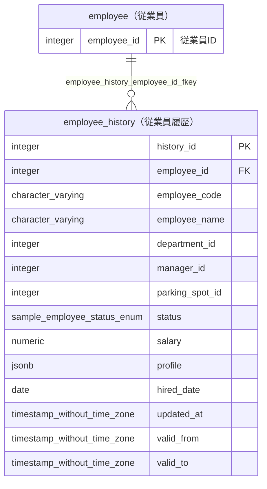

# employee_history（従業員履歴）

## 基本情報

| RDBMS | データベース名 | 作成日 |
|:---|:---|:---|
|PostgreSQL 16|testdb|2026/10/13|

## テーブル説明

## テーブル情報

| スキーマ名 | 論理テーブル名 | 物理テーブル名 | 区分 | 備考 |
|:---|:---|:---|:---|:---|
|sample|従業員履歴|employee_history|table||

## 所属する観点

* [人事管理](../../viewpoint_testdb_personnel.md)  

## カラム情報

| No. | 論理名 | 物理名 | データ型 | 桁数/精度 | PK | Not Null | デフォルト | 備考 |
|:---|:---|:---|:---|:---|:---|:---|:---|:---|
|1||history_id|integer||○|○|nextval('sample.employee_history_history_id_seq'::regclass)||
|2||employee_id|integer|||○|||
|3||employee_code|character varying(10)|10||○|||
|4||employee_name|character varying(100)|100||○|||
|5||department_id|integer|||○|||
|6||manager_id|integer||||||
|7||parking_spot_id|integer||||||
|8||status|sample.employee_status_enum|||○|||
|9||salary|numeric(10,2)|10,2||○|||
|10||profile|jsonb|||○|||
|11||hired_date|date|||○|||
|12||updated_at|timestamp without time zone|||○|||
|13||valid_from|timestamp without time zone|||○|||
|14||valid_to|timestamp without time zone||||||

## インデックス情報

| No. | インデックス名 | 種別 | UNIQUE | PRIMARY | 定義 | 備考 |
|:---|:---|:---|:---|:---|:---|:---|
|1|employee_history_pkey|btree|○|○|CREATE UNIQUE INDEX employee_history_pkey ON sample.employee_history USING btree (history_id)||

## 制約情報

| No. | 制約名 | 種類 | 制約定義 | 備考 |
|:---|:---|:---|:---|:---|
|1|employee_history_employee_id_fkey|FOREIGN KEY|FOREIGN KEY (employee_id) REFERENCES sample.employee(employee_id)||
|2|employee_history_pkey|PRIMARY KEY|PRIMARY KEY (history_id)||

## 外部キー情報

| No. | 外部キー名 | カラムリスト | 参照先 | 参照先カラムリスト | 多重度 |
|:---|:---|:---|:---|:---|:---|
|1|employee_history_employee_id_fkey|employee_id|sample.employee|employee_id|1対多|

## トリガー情報

| No. | トリガー名 | タイミング | イベント | 単位 | 定義 |
|:---|:---|:---|:---|:---|:---|

## ER図

___

[テーブル一覧へ](../../tableList_testdb.md)
